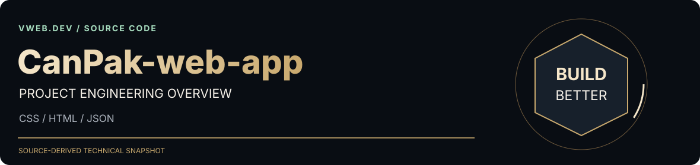

<!-- VWEB:AUTO-README:START -->

### Code-derived project snapshot

| Attribute | Detected value |
|---|---|
| Latest source revision | `358340a21522` |
| Tracked files reviewed | 9 |
| Framework and platform indicators | CSS  /  HTML  /  JSON |
| Source file types | CSS (1), HTML (1), JSON (1), JavaScript (1) |
| Main directories | css, js |

> This section is regenerated from tracked filenames and manifests on code updates. It is not a QA or production-readiness certification. Handwritten project documentation is preserved.
<!-- VWEB:AUTO-README:END -->

# CanPak-web-app